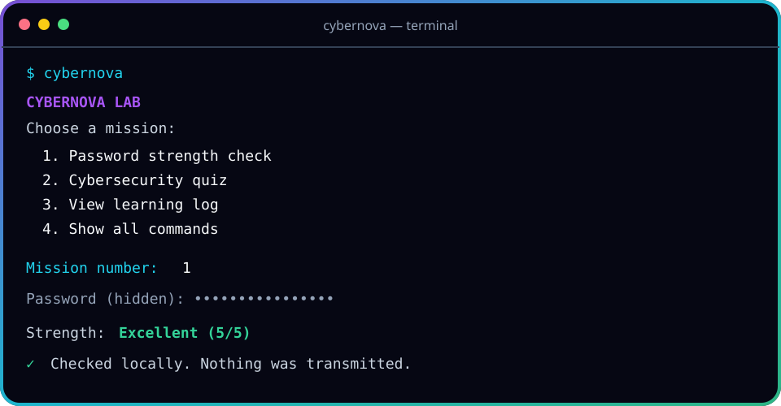

<div align="center">
  
  <br><br>
  <a href="https://www.python.org/"></a>
  <a href="LICENSE"></a>
  <a href="CONTRIBUTING.md"></a>
  <br><br>
  <strong>A safe, dependency-free cybersecurity playground for curious beginners.</strong>
  <br>
  Built by a first-year B.Tech Cyber Security student, one concept at a time.
</div>

## Why I built this

CyberNova Lab turns foundational security ideas into small terminal experiments. I created it to practise Python, understand defensive security concepts, learn professional GitHub workflows, and document my progress in public.

> [!IMPORTANT]
> This is an educational, defensive project. It does not attack networks, collect credentials, or send your data anywhere. Only test systems and files you own or have permission to use.

## Missions included

| Mission | What it demonstrates | What you learn |
|---|---|---|
| Password analyser | Transparent strength rules | Passphrases, character variety, common-pattern risk |
| SHA-256 lab | Text and streaming file hashes | One-way digests and file fingerprints |
| Integrity monitor | Create and compare manifests | Detecting added, removed, or modified files |
| Security quiz | Interactive questions with explanations | CIA triad, phishing, MFA, backups, least privilege |
| Learning log | Local study-topic tracker | JSON, persistence, and consistent learning |

<div align="center">
  
</div>

## Quick start

You need [Python 3.10 or newer](https://www.python.org/downloads/). Then open a terminal inside this folder. The fastest start needs no installation:

```bash
python run.py
```

For the reusable `cybernova` command, create an environment and install the project:

```bash
# Create an isolated environment
python -m venv .venv

# Windows PowerShell
.venv\Scripts\Activate.ps1

# macOS or Linux
source .venv/bin/activate

# Install the project in editable mode
python -m pip install -e .

# Launch the interactive menu
cybernova
```

No third-party runtime packages are required.

## Try the commands

```bash
# Type a password invisibly and analyse it only on your computer
cybernova password

# Learn how a text fingerprint looks
cybernova hash --text "hello cyber world"

# Hash a file
cybernova hash --file README.md

# Save the current state of a folder, then check it later
cybernova integrity create ./docs --manifest docs-manifest.json
cybernova integrity check ./docs --manifest docs-manifest.json

# Take a five-question fundamentals quiz
cybernova quiz --count 5

# Build a private, local learning streak
cybernova learn add "Linux file permissions"
cybernova learn list
```

## Project map

```text
cybernova-lab/
├── .github/                 issue templates and automated workflows
├── assets/                  custom GitHub artwork
├── docs/                    architecture, learning path, and publishing guide
├── src/cybernova/           application source code
├── tests/                   standard-library unit tests
├── CONTRIBUTING.md          contribution workflow
├── LICENSE                  MIT open-source license
├── pyproject.toml           package metadata and command setup
├── run.py                   zero-install launcher
└── README.md                project home page
```

## Run the quality checks

```bash
python -m unittest discover -s tests -v
python -m compileall -q src tests
```

GitHub Actions runs these checks automatically on every push and pull request.

## Roadmap

- [x] Password strength learning tool
- [x] SHA-256 text and file hashing
- [x] File-integrity manifests
- [x] Security fundamentals quiz
- [x] Local learning tracker
- [ ] Export a learning report as Markdown
- [ ] Add more quiz topics and difficulty levels
- [ ] Add a safe log-analysis exercise using sample data
- [ ] Reach 90% automated test coverage

Ideas are tracked in [GitHub Issues](../../issues). Beginner-friendly tasks use the `good first issue` label.

## Learn, contribute, connect

- Read the [four-week learning path](docs/LEARNING_PATH.md).
- See [how the code is organised](docs/ARCHITECTURE.md).
- Follow the [step-by-step GitHub publishing guide](docs/GITHUB_GUIDE.md).
- Check [CONTRIBUTING.md](CONTRIBUTING.md) before opening a pull request.

If this project helped you learn something, consider starring it. Feedback and kind contributions are welcome.

## Author

**sansw123** — first-year B.Tech Cyber Security student

- GitHub: [@sansw123](https://github.com/sansw123)

## License

Released under the [MIT License](LICENSE). You may learn from, modify, and share this project with attribution.
