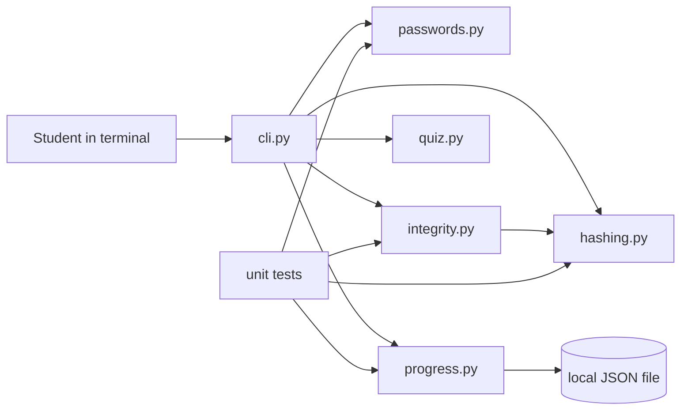

# CyberNova architecture

CyberNova uses a small `src`-layout Python package. It has no runtime dependencies, network access, database, or account system.

## Modules

| Module | Responsibility |
|---|---|
| `cli.py` | parses commands, displays results, and handles expected user errors |
| `passwords.py` | applies transparent local strength checks and returns suggestions |
| `hashing.py` | creates cryptographic digests for text and chunked files |
| `integrity.py` | snapshots file hashes and compares a later directory state |
| `quiz.py` | stores questions and runs the interactive learning loop |
| `progress.py` | saves and reads the local study-topic log |

## Data and privacy

- Passwords exist only in process memory while a check runs.
- The password command does not log or transmit values.
- Hash and integrity commands read only paths selected by the user.
- Learning topics are stored in `.cybernova-progress.json` in the current folder and ignored by Git.
- Symlinks and common generated folders are skipped by the integrity scanner.

## Design decisions

**Standard library only.** Beginners can clone and run the project without resolving package versions. The trade-off is a simpler terminal interface.

**Functions return structured data.** The password and integrity modules do not print directly, which makes them easier to test and reuse.

**A manifest detects change, not intent.** A changed digest shows that bytes differ; it cannot say who changed them, why they changed, or whether the new file is malicious.

**Educational password rules.** The analyser teaches useful habits but does not estimate real-world cracking cost or check known breaches. A password manager remains the better way to create and store unique credentials.

## Adding a new mission

1. Put reusable logic in a focused module under `src/cybernova/`.
2. Return data instead of printing from core logic.
3. Add the command in `cli.py`.
4. Add unit tests under `tests/`.
5. Document the command and its safety boundary in `README.md`.

